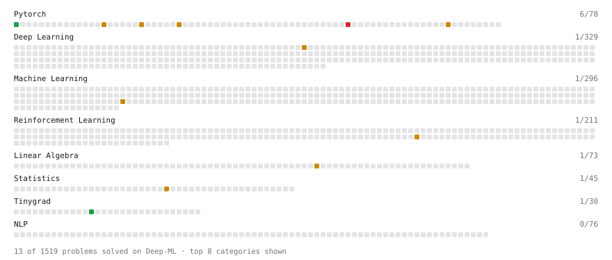

# Deep-ML

My machine learning practice from [Deep-ML](https://www.deep-ml.com). Every solution here was written by hand.

**14** solved · 14 problems · 0 labs · 0 math

[**Browse the interactive portfolio**](https://theBaoo.github.io/deep-ml/) to replay this filling in over time.

## Problems

| | Difficulty | Solved | |
| --- | --- | --- | --- |
| [Balance Dataset via Undersampling](https://www.deep-ml.com/problems/1057) | easy | 2026-10-14 | [solution](problems/1057-balance-dataset-via-undersampling) |
| [Create a Float Tensor from a Python List](https://www.deep-ml.com/problems/880) | easy | 2026-10-01 | [solution](problems/0880-create-a-float-tensor-from-a-python-list) |
| [Tinygrad: Implement Dropout from Scratch](https://www.deep-ml.com/problems/922) | easy | 2026-10-13 | [solution](problems/0922-tinygrad-implement-dropout-from-scratch) |
| [Analyze Singular Value Spectrum to Determine Intrinsic Rank](https://www.deep-ml.com/problems/876) | medium | 2026-10-03 | [solution](problems/0876-analyze-singular-value-spectrum-to-determine-intrinsic-rank) |
| [BIRCH Clustering for Large Datasets](https://www.deep-ml.com/problems/825) | medium | 2026-09-20 | [solution](problems/0825-birch-clustering-for-large-datasets) |
| [Compute-Matched Looped MoE Configuration (SMELT)](https://www.deep-ml.com/problems/1394) | medium | 2026-10-11 | [solution](problems/1394-compute-matched-looped-moe-configuration-smelt) |
| [Dropout Layer](https://www.deep-ml.com/problems/151) | medium | 2026-09-28 | [solution](problems/0151-dropout-layer) |
| [Gradient Clipping by Norm](https://www.deep-ml.com/problems/909) | medium | 2026-10-01 | [solution](problems/0909-gradient-clipping-by-norm) |
| [Implement a Custom `autograd.Function`](https://www.deep-ml.com/problems/903) | medium | 2026-10-01 | [solution](problems/0903-implement-a-custom-autograd-function) |
| [Implement Focal Loss](https://www.deep-ml.com/problems/915) | medium | 2026-10-01 | [solution](problems/0915-implement-focal-loss) |
| [Poisson Deviance and Overdispersion](https://www.deep-ml.com/problems/1367) | medium | 2026-09-29 | [solution](problems/1367-poisson-deviance-and-overdispersion) |
| [Resource Dilation Factor for Scheduling](https://www.deep-ml.com/problems/623) | medium | 2026-10-04 | [solution](problems/0623-resource-dilation-factor-for-scheduling) |
| [Zero-Copy Batch Data Loading from Shared Memory](https://www.deep-ml.com/problems/659) | medium | 2026-10-10 | [solution](problems/0659-zero-copy-batch-data-loading-from-shared-memory) |
| [Trade Compute for Memory with Gradient Checkpointing](https://www.deep-ml.com/problems/1342) | hard | 2026-09-23 | [solution](problems/1342-trade-compute-for-memory-with-gradient-checkpointing) |

---

_This file is regenerated by Deep-ML on every push._
